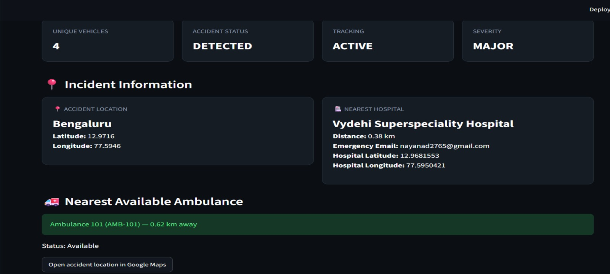
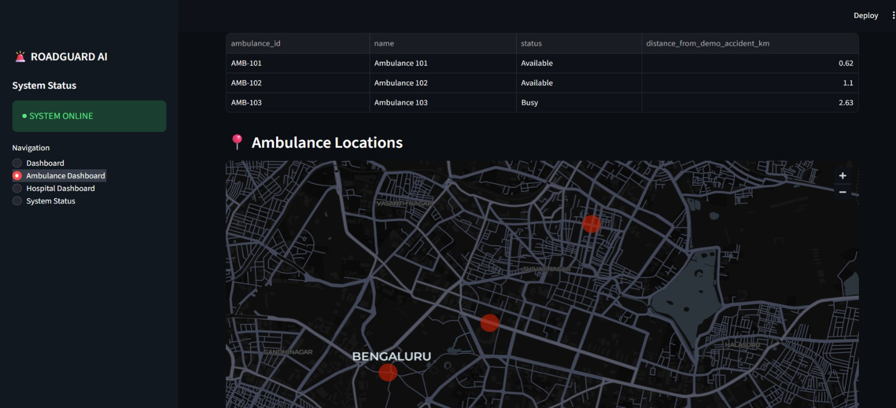
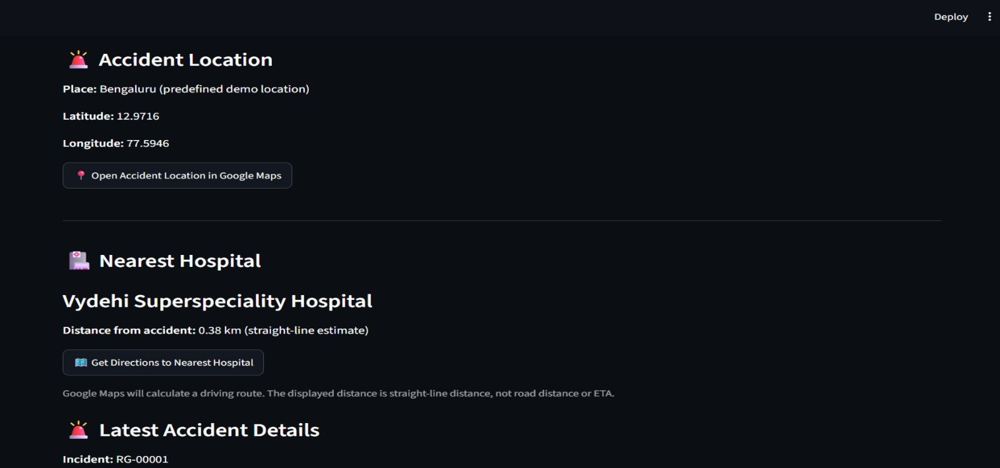
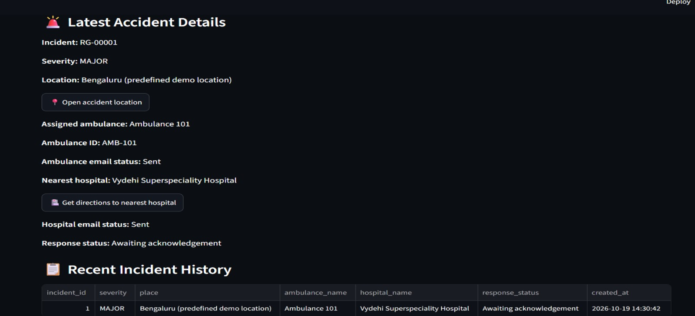
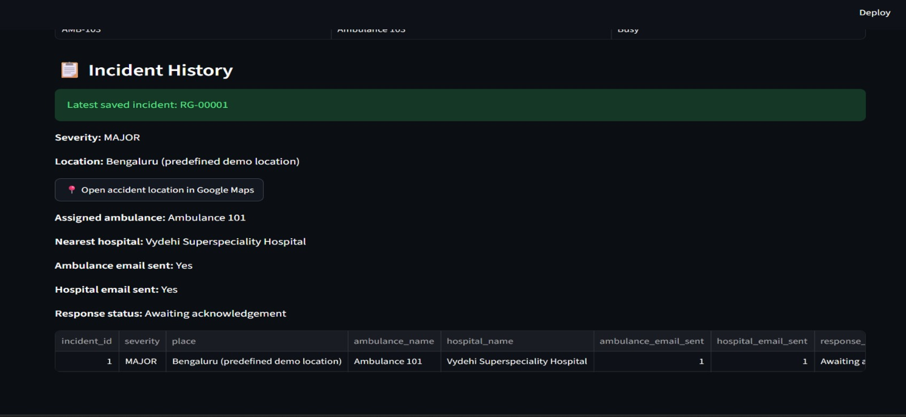
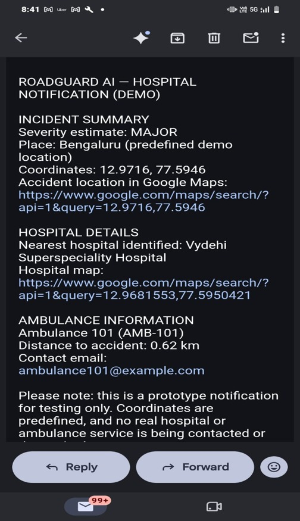
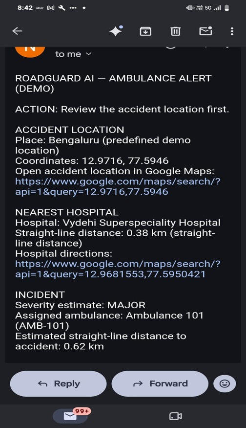
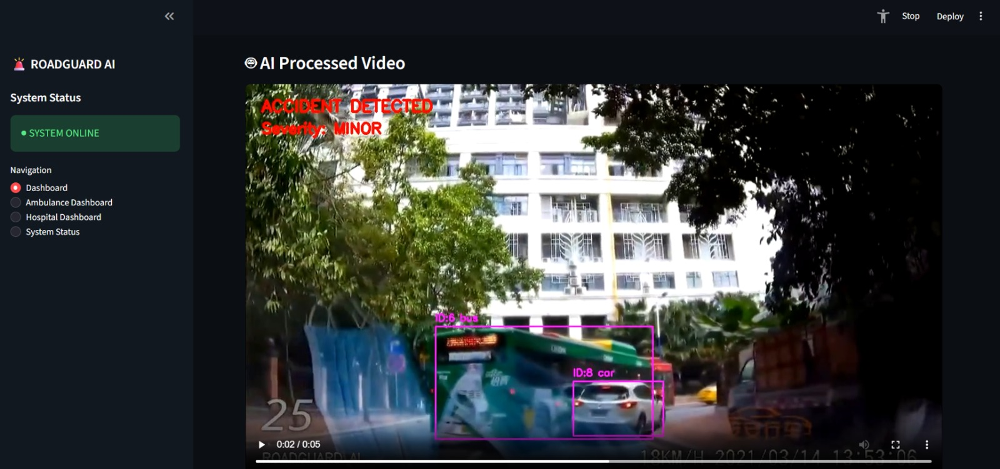

\# 🚗 RoadGuard AI

\### AI-Powered Road Accident Detection and Emergency Notification System


\## 📌 Overview

RoadGuard AI is an intelligent accident detection system designed to identify road accidents from video footage and support faster emergency response.


It uses computer vision and deep learning to analyse video frames, detect potential accidents, identify nearby hospitals and send emergency email notifications.


\## ✨ Key Features


\- \*\*Accident Detection:\*\* Detects potential road accidents using deep learning.

\- \*\*Vehicle Tracking:\*\* Tracks vehicles using YOLO and ByteTrack.

\- \*\*Severity Estimation:\*\* Estimates accident severity.

\- \*\*Hospital Identification:\*\* Finds nearby hospitals using location-based services.

\- \*\*Email Notifications:\*\* Sends accident alerts through email.

\- \*\*Interactive Dashboard:\*\* Provides a Streamlit-based interface.

\- \*\*Incident Management:\*\* Stores incident information using SQLite.


\## 🛠️ Technologies Used


| Technology | Purpose |

|---|---|

| Python | Main programming language |

| PyTorch | Deep learning |

| MobileNetV2 | Accident classification |

| YOLO11 | Object detection |

| ByteTrack | Object tracking |

| OpenCV | Video processing |

| Streamlit | Web dashboard |

| SQLite | Database |

| Folium | Map visualization |

| Overpass API | Nearby hospital search |

## 📸 Project Screenshots

### Dashboard











### Email Notifications





### Video Detection




\## 🏗️ System Workflow


1\. Input road video.

2\. Extract and process video frames.

3\. Detect and track vehicles.

4\. Classify frames as Accident or Non Accident.

5\. Estimate accident severity.

6\. Identify nearby hospitals.

7\. Send emergency email notifications.

8\. Display incident information on the dashboard.


\## ⚙️ Installation


\### 1. Clone the repository


```bash

git clone https://github.com/Nayana20-05/RoadGuard-AI.git

```


\### 2. Navigate to the project directory


```bash

cd RoadGuard-AI

```


\### 3. Install dependencies


```bash

pip install -r requirements.txt

```


\### 4. Run the application


```bash

streamlit run app.py

```


\## 📂 Project Structure


```text

RoadGuard-AI/

│

├── app.py

├── app\_backup.py

├── train\_model.py

├── database.py

├── location\_utils.py

├── seed\_data.py

├── check\_db.py

├── Tests/

├── Dataset/

├── Test\_videos/

├── Outputs/

├── requirements.txt

└── README.md

```
## 📦 Model and Dataset Setup

RoadGuard AI requires pretrained model files and supporting dataset files to run.

### Required Files

- `yolo11n.pt` – YOLO object detection model.
- `roadguard_accident_model.pth` – Trained MobileNetV2 accident classification model.
- `Dataset/hospital.csv` – Hospital information used by the application.

### Setup Instructions

1. Download or obtain the required model files.
2. Place `yolo11n.pt` and `roadguard_accident_model.pth` in the project root directory.
3. Create a `Dataset` folder.
4. Place `hospital.csv` inside the `Dataset` folder.
5. Configure the environment variable `ROADGUARD_APP_PASSWORD` for email notifications.

**Note:** Model weights and dataset files are not included in this GitHub repository.


\## 🚀 Future Enhancements


\- Improve accident classification accuracy.

\- Implement real-time CCTV integration.

\- Improve accident severity classification.

\- Integrate additional emergency response services.


\## 👩‍💻 Author


\*\*Nayana D\*\*


Information Science and Engineering


GitHub: https://github.com/Nayana20-05


\---


\*RoadGuard AI – Towards safer roads through artificial intelligence.\*

